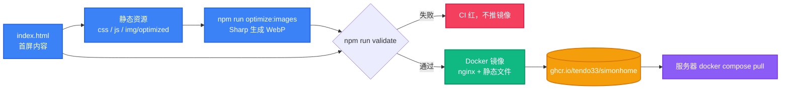

<div align="center">


# SimonHome

**SimonSun 的个人主页：一个不依赖框架、不需要打包器的纯静态站点。**

原生 HTML + CSS + JavaScript，Nginx 直接托管，Docker 部署，构建一次就是最终产物。

[](index.html)
[](static/css)
[](static/js)
[](nginx.conf)

[](package.json)
[](Dockerfile)
[](LICENSE)

[快速开始](#快速开始) · [站点是怎么运行的](#站点是怎么运行的) · [内容维护](#内容维护) · [部署](#docker-部署)

<sub>中文</sub>


</div>

---

## 项目简介

基于 [ZYYO666/homepage](https://github.com/ZYYO666/homepage) 二次开发，保留纯静态站点的部署方式，并补充了测试、校验和资源优化流程。

运行时没有框架，也没有打包器。首页核心内容直接写在 `index.html` 里，保证首屏直出；交互逻辑由模块化脚本负责；Nginx 只负责把静态文件发出去。

## 技术栈

| 层 | 用什么 |
| --- | --- |
| 页面 | 原生 HTML / CSS / JavaScript（ES Module） |
| 服务器 | Nginx，静态文件直出 |
| 部署 | Docker / Docker Compose |
| 构建期工具 | Node.js，只用于校验、测试和图片优化 |

Node.js 只在开发和 CI 阶段出现，线上镜像里没有它。

## 目录说明

```
index.html                主页入口与首屏内容
404.html                  404 页面
static/css/               主题与样式
static/js/                页面交互逻辑（ES Module）
static/img/optimized/     运行时使用的优化图片
scripts/                  optimize-images.mjs、validate-links.mjs
tests/                    Vitest + jsdom 冒烟测试
nginx.conf                静态托管配置
Dockerfile / docker-compose*.yml
```

## 快速开始

```bash
npm install
```

本地预览起一个静态服务器即可（直接双击 `index.html` 会有 file:// 协议导致的加载限制）：

```bash
python3 -m http.server 8000
```

然后打开 <http://localhost:8000>。

改了背景图、头像或大尺寸卡片图标之后，重新生成优化资源：

```bash
npm run optimize:images
```

## 校验

```bash
npm test            # Vitest + jsdom 冒烟测试
npm run validate    # 完整校验：测试 + HTML 结构 + 本地链接
```

`npm run validate` 依次做三件事：

| 步骤 | 命令 | 检查什么 |
| --- | --- | --- |
| 冒烟测试 | `vitest run --environment jsdom` | 页面能加载、关键区块和脚本存在 |
| HTML 校验 | `html-validate index.html 404.html` | 标签结构、属性合法性 |
| 链接校验 | `node scripts/validate-links.mjs` | 本地资源与链接都能找到 |

CI 在每次 PR 上跑的就是这一条 `validate`。

## 站点是怎么运行的

纯静态站点没有请求链路，只有「改内容 → 校验 → 出镜像」这条路：



## 内容维护

首页首屏内容直接维护在 `index.html`。更新 `Sites`、`Projects`、`Plugins` 卡片时，保持现有 DOM 结构、类名和图片资源路径不变，避免影响已有样式和交互逻辑。

替换图片后记得跑一次 `npm run optimize:images`，否则 `static/img/optimized/` 里还是旧图。

## Docker 部署

镜像由 CI 构建并推到 `ghcr.io/tendo33/simonhome`（`linux/amd64`、`linux/arm64`），服务器只拉镜像：

```bash
docker compose pull && docker compose up -d
```

固定或回滚版本时指定标签，例如 `IMAGE_TAG=sha-abc1234 docker compose up -d`。

镜像只包含运行所需的 `index.html`、`static/` 和 `nginx.conf`，不会把历史文件、文档和开发依赖一起打包进去。本地要自己构建时：

```bash
docker compose -f docker-compose.yml -f docker-compose.build.yml up -d --build
```

## CI 与发布

| 触发 | workflow | 做什么 |
| --- | --- | --- |
| PR | `ci.yml`、`image.yml` | 执行 `npm run validate`，并试构建镜像（不推送） |
| 推 `main` | `image.yml` | 校验通过后推送 `sha-<7 位>` 和 `latest` |
| 推 `v*` 标签 | `image.yml`、`release.yml` | 校验通过后推送 `<版本>`、`<主>.<次>`，并创建 GitHub Release |

校验失败时不会推镜像，也不会发 Release。

## 许可证

MIT，见 [LICENSE](LICENSE)。
